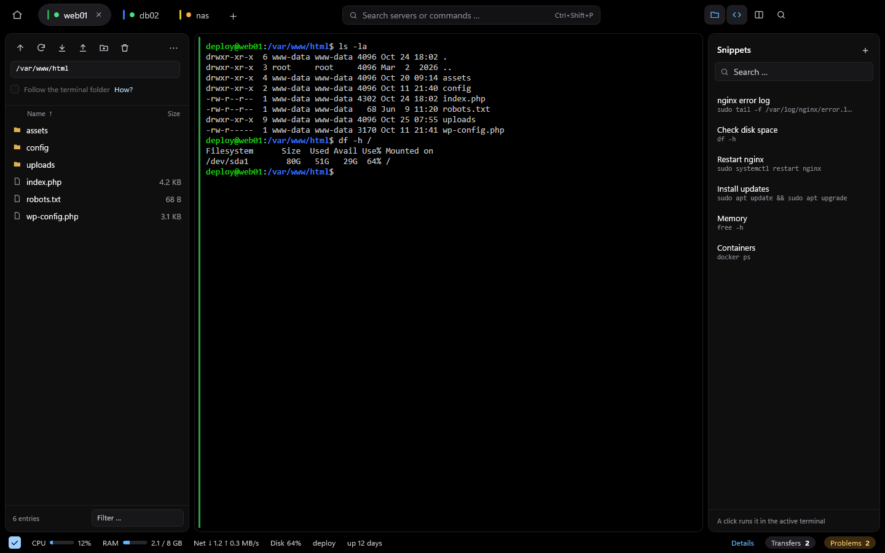
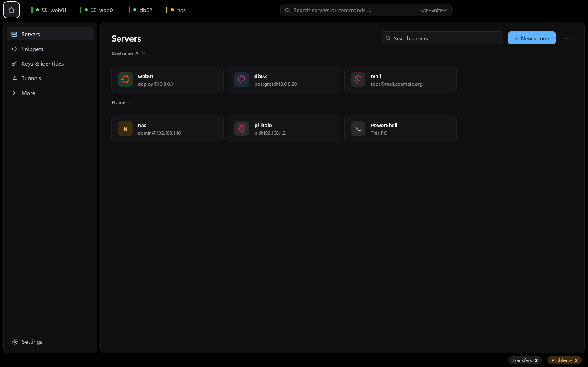
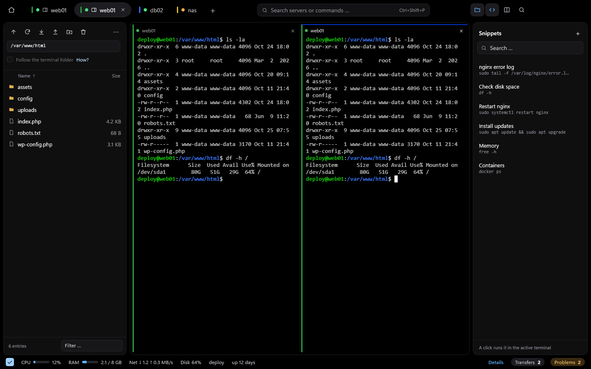

# NexusSSH

A Windows SSH client with a built-in SFTP file manager — a lightweight alternative to MobaXterm.
WinUI 3 front end (C# / .NET 10), Rust core.



> **Status:** version 0.2.0 (the first public release was 0.1.0). SSH sessions with a terminal (including jump hosts), server profiles with
> `~/.ssh/config` import, an SFTP browser with up-/download and edit-in-place, server monitoring, split terminals,
> search, color schemes, a command palette, saved commands, local terminals, Mosh and AI access through MCP. Full
> list: [`FEATURES.md`](FEATURES.md).

The active terminal tab drives everything: it decides which server the file pane on the left, the snippets on the
right and the load bar under the terminal belong to. The start page lists your servers as tiles.



## Highlights

- **Terminal** — xterm.js, 256 colors, 10k lines of scrollback, copy/paste, in-terminal search. Tabs can be
  reordered by dragging, and **up to sixteen sessions share the terminal area** in any nested arrangement – drag the dividers, drag a pane by its header to rearrange, zoom one. Extra
  sessions to the same server reuse the open connection — no second sign-in.

  

- **SFTP file manager** — browse, up-/download files *and whole folders*, rename, delete, change permissions and
  ownership (like `chmod`/`chown`). **Double-click to edit** a remote file in your editor; every save uploads it
  again. **Drag files and folders straight into Explorer** (or copy & paste) — loading starts only once you drop.
- **Transfers that survive** — many small files go in parallel; interrupted uploads and downloads **resume where
  they left off**, across a reconnect, an app restart, even a crash.
- **Connections** — key file, SSH agent (Windows OpenSSH agent or Pageant, and with it keys held in Bitwarden or a
  self-hosted Vaultwarden: name the public key file in the profile to pick one), default `~/.ssh` keys, password, and
  server prompts (2FA); verified key passphrases. **Jump hosts** like `ProxyJump`, chained, each verified and
  signed in on its own. Optional, per-profile **agent forwarding** (off by default; a jump host never gets the
  agent). **Port forwarding** per server: local, remote and dynamic (SOCKS) tunnels that stand while a
  connection to the server stands; they listen for this computer only unless you say otherwise. **Mosh** per
  profile: the terminal runs over UDP and survives dead spots and a change of network, with typing shown at once;
  sign-in, files and server info stay on SSH, and without `mosh-server` or UDP the terminal falls back to SSH.
- **Local terminal** — a shell of this computer in a tab (PowerShell, Command Prompt, WSL, Git Bash; the login
  shell on Unix) with `Ctrl+Shift+T`, from the palette or as a saved profile with a start folder. It stays on
  this computer and is never part of an export.
- **Server load** — CPU, RAM, network, disk and uptime of Linux, FreeBSD, OpenBSD and Windows servers in a bar
  under the terminal; the Server details page adds every core, memory details, all file systems, network interfaces
  and disk throughput. Measured only while one of them is visible.
- **AI access through MCP** — programs like Claude Code can use NexusSSH's connections, for example to debug a
  server, without ever seeing a key or password. Off by default, only for servers you release, and **every command
  needs your approval** in a dialog that shows it in full; approved commands are typed into the terminal, so you
  watch them run.
- **Command palette** (`Ctrl+Shift+P`) — connect to servers, switch tabs, run commands, send saved snippets.
- **Also** — eight color schemes, cross-terminal search, save terminal history, import from `~/.ssh/config`,
  profile export/import (never secrets), an optional update check against the GitHub releases (once a day, a lone
  request to GitHub — no account, no data), and a UI in English, German, French and Spanish (more languages are welcome as pull requests).

Secrets stay with the core: passwords and passphrases live in the **Windows Credential Manager** and only on
request — never in a file. `~/.ssh/known_hosts` and `~/.ssh/config` are read, never written.

## How it compares

An honest snapshot against the usual Windows suspects — including where NexusSSH is still behind. Legend: ✅ yes ·
◐ partial / paid / planned · ❌ no.

| | **NexusSSH** | MobaXterm | Termius | PuTTY + WinSCP | WindTerm |
|---|:---:|:---:|:---:|:---:|:---:|
| Platform | Windows¹ | Windows | Win/mac/Linux/**iOS/Android** | Windows | Win/mac/Linux |
| Price / license | **free, MIT** | freemium | freemium (sync paid) | free, OSS | free, Apache-2.0 |
| Fully local, no account | ✅ | ✅ | ◐ | ✅ | ✅ |
| Protocols beyond SSH/SFTP | ◐ Telnet/Serial/FTP/Mosh | ✅ RDP/VNC/Telnet/Serial/Mosh | ◐ Telnet/Mosh | ◐ Telnet/Serial | ◐ Telnet/Serial/Tmux |
| Terminal tabs + split | ✅ (up to 16) | ✅ | ✅ | ❌ | ✅ |
| SFTP file manager | ✅ | ✅ | ✅ | ✅ (WinSCP) | ✅ |
| Edit remote file in editor | ✅ | ✅ | ◐ | ✅ | ✅ |
| Drag & drop into Explorer (incl. folders) | ✅ | ◐ | ❌ | ✅ | ◐ |
| Resume transfers (reconnect/restart/**crash**) | ✅ | ◐ | ◐ | ✅ | ◐ |
| Jump hosts (ProxyJump, chained) | ✅ | ✅ | ✅ | ✅ | ✅ |
| Agent forwarding | ✅ | ✅ | ✅ | ✅ | ✅ |
| **Port forwarding (L/R/D tunnels)** | ✅ | ✅ | ✅ | ✅ | ✅ |
| X11 forwarding | ◐ (needs an X server) | ✅ (X server bundled) | ❌ | ◐ | ✅ |
| Multi-exec / broadcast | ◐ (split panes) | ✅ | ✅ | ❌ | ✅ |
| `~/.ssh/config` import | ✅ | ◐ | ✅ | ❌ | ◐ |
| Snippets / saved commands | ✅ | ✅ | ✅ | ❌ | ✅ |
| Server resource monitor | ✅ | ◐ | ❌ | ❌ | ❌ |
| Cloud sync | ❌ *(export/import)* | ❌ | ✅ (paid) | ❌ | ❌ |
| Maturity | young (v0.1) | very mature | very mature | very mature | mature |

¹ Linux is kept possible but not shipped.

**Where NexusSSH wins:** rock-solid SFTP transfers (resume across reconnect, restart and crash; folders in
parallel; drag whole folders into Explorer), lighter than Electron-based clients, fully local with no
account or telemetry, a built-in server resource monitor, and free under MIT.

**Where it's still behind:** no RDP or VNC, no bundled X server (X11 forwarding needs one such as VcXsrv),
broadcast only to the panes of a split terminal, no cloud sync (by design), Windows-only, young, a heavier footprint
than native terminals (the terminal runs in WebView2), and the installer isn't code-signed. If you need a Swiss-army knife, MobaXterm is broader; for multi-device with sync,
Termius; for a broad native open-source all-rounder, WindTerm.

## Install

Pre-built downloads are attached to this repository's releases:

- **`NexusSSH-Setup-<version>.exe`** — per-user installer, no admin rights (installs to `%LOCALAPPDATA%\Programs`).

It needs Windows 10 2004 or newer (x64) and the WebView2 runtime (bundled with Windows 11).

## Build

Requirements:

- Windows 10 2004 or newer (built for Windows 11), x64
- .NET SDK 10.0.403 (`global.json`)
- Rust (stable) with `cargo` on `PATH`
- Visual Studio Build Tools 2022 with the C++ workload (the linker for the Rust core)
- WebView2 runtime (bundled with Windows 11)

```powershell
dotnet build NexusSSH.slnx
dotnet test --solution NexusSSH.slnx
& "$env:LOCALAPPDATA\NexusSSH.build\artifacts\bin\NexusSSH.App\debug_win-x64\NexusSSH.exe"
```

The build invokes `cargo` for the Rust core itself. Output goes to `%LOCALAPPDATA%\NexusSSH.build`, not into the
repo. `NexusSSH.exe --demo` starts with sample data instead of real connections.

The shipped installer (Native AOT) is built by `./tools/make-release.ps1`; that needs
Inno Setup 6.

To try it without a server of your own, there is a small SSH test server with SFTP (127.0.0.1:2222, user `demo`,
password `demo`). It also works as a jump host and fakes a Linux server in the inspector:

```powershell
cargo run --manifest-path backend/Cargo.toml -p nexus-testserver --target-dir "$env:LOCALAPPDATA\NexusSSH.build\cargo"
```

## Documentation

- [`FEATURES.md`](FEATURES.md) — everything NexusSSH can do
- [`docs/architecture.md`](docs/architecture.md) — layout, the Rust-core interface, security
- [`docs/deployment.md`](docs/deployment.md) — silent install (German)
- [`CONTRIBUTING.md`](CONTRIBUTING.md) — pull requests, and how to correct a translation or add a language

## Third-party material

`frontend/NexusSSH.App/Assets/terminal/vendor` contains [xterm.js](https://github.com/xtermjs/xterm.js) with its
fit and search addons (MIT), checked in without npm. Versions and checksums are in `VERSIONS.txt` next to it;
update with `tools/vendor-xterm.ps1`. The Rust core builds on [russh](https://github.com/warp-tech/russh)
(Apache-2.0).

`backend/mosh-client` is a checked-in copy of [mosh-client-rs](https://github.com/wandcs/mosh-client-rs) 0.1.4 (an
independent Mosh client in Rust, MIT or Apache-2.0, copyright 2026 “di” as in `LICENSE-MIT` and `LICENSE-APACHE` there), with
its embedded `vt100` terminal emulator (MIT, Jesse Luehrs, `src/vt100/LICENSE`). The licence files are unchanged;
what differs from the original is listed with reasons and tests in `backend/mosh-client/PATCHES.md`.

## License

[MIT](LICENSE).
